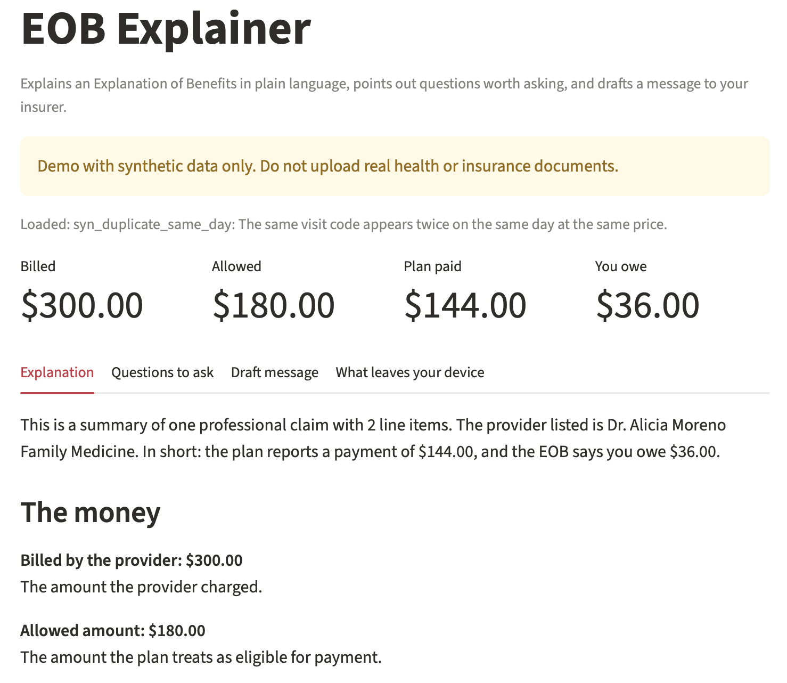
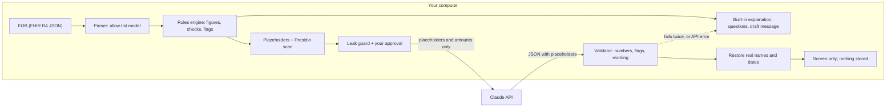

# EOB Explainer


**A patient-facing tool that turns a FHIR `ExplanationOfBenefit` into a plain-language explanation, points out questions worth asking, and drafts a message to the insurer. Built privacy-first, on synthetic data only.**

> Portfolio project. Not medical, legal, or billing advice. It never says a bill is wrong; it helps you ask good questions.




**Contents:** [Problem](#1-the-problem) · [Users](#2-who-it-is-for) · [Principles](#3-product-principles) · [MVP](#4-mvp-and-user-stories) · [Cuts](#5-what-i-cut-and-why) · [How it works](#6-how-it-works) · [Safety](#7-safety-guardrails) · [Privacy](#8-privacy-design) · [Evaluation](#9-evaluation) · [Decisions](#10-decisions-and-what-building-it-taught-me) · [Limits](#11-limitations-and-risks) · [Run it](#12-run-it) · [Repo map](#13-repository-map) · [Next](#14-what-is-next) · [Data and licenses](#16-data-sources-licenses-attribution) · [Docs index](docs/README.md)

## Independence and data statement

- This is a personal learning project, built on personal time and personal equipment.
- It uses no employer code, data, documents, or confidential knowledge, and is not affiliated with or derived from any employer's product.
- **Synthetic or public data only.** No real patient data is used, ever. All names in the test data (providers, members) are fictional.
- Not affiliated with HL7, CMS, or Anthropic. It uses HL7's public CARIN Blue Button example resources and Anthropic's Claude API.

## 1. The problem

An Explanation of Benefits (EOB) is what a health plan sends after it processes a claim. It is dense, full of codes, and easy to misread. People cannot tell what they owe, why, or whether anything deserves a question. Some pay without asking; others call the insurer without knowing what to ask.

The data is increasingly available in machine-readable form. The CMS Interoperability and Prior Authorization rule (CMS-0057-F, published February 2024) requires Medicare Advantage organizations, state Medicaid and CHIP programs and their managed care plans, and Qualified Health Plan issuers on the federal exchanges to maintain FHIR-based APIs. It builds on the 2020 Patient Access rule and adds prior authorization information to the Patient Access API by January 1, 2027. Original Medicare is outside that rule; its separate Blue Button 2.0 API serves a similar purpose. Raw FHIR is unreadable to a patient, so the gap is explanation.

This project works with the payer-neutral FHIR R4 format used by claims APIs (the CARIN Blue Button profile), so it models what a consumer app built on a payer's Patient Access API would receive.

## 2. Who it is for

**Primary user:** a health plan member who has just received an EOB and is not a billing expert.

Jobs to be done:
1. "Tell me what I owe, and why."
2. "Tell me whether anything is worth asking about."
3. "Help me ask, without starting from a blank page."

Not built: caregivers or advocates acting for someone else; providers (that is the planned Project B).

## 3. Product principles

1. **Facts from code, words from the model.** A rules engine computes every number and flag. A language model may only rephrase verified facts, and code checks its answer.
2. **Questions, never conclusions.** Flags are phrased as questions for the insurer or the provider's billing office. The tool never says a charge is wrong, an error, or an overcharge, and gives no medical or legal advice.
3. **Privacy by structure.** The parser is an allow-list, so a patient name cannot reach the explainer because the schema cannot carry it. Redaction is a second layer, not the first.
4. **The AI is optional.** Without it (or when its answer fails verification), the user still gets a correct, plainer explanation.
5. **Honest about uncertainty.** "The EOB does not state this" is never shown as $0.

## 4. MVP and user stories

One FHIR R4 `ExplanationOfBenefit` in (a sample or an uploaded file); on screen only:

- **What happened:** a plain-language summary and the money: billed, allowed, plan paid, what you owe.
- **Questions to ask:** up to five rule-based flags (repeated service on one day, large share of the allowed amount, part of the balance not itemized, non-covered amount, adjustment lines).
- **Draft message:** a short written question to the insurer, assembled locally from fixed, tested templates.
- **Two modes:** built-in (nothing leaves the computer) or Claude with redaction (you approve the exact payload first).

User stories:
- As a member, I want to know what I owe and why, so I can decide whether to pay.
- As a member, I want unusual items pointed out as questions, so I know what to ask.
- As a member, I want a draft message I can edit, so I do not start from a blank page.
- As a privacy-conscious member, I want to see exactly what leaves my device before anything is sent.
- As a member, I want the tool to say when to ask my insurer or provider, because it cannot say a bill is wrong.

## 5. What I cut, and why

| Cut | Why |
|---|---|
| Live OAuth / Patient Access connection | Plumbing, not the learning goal. Claims are loaded from a file. |
| Medicare Blue Button sandbox data | The sandbox API refused command-line requests at the network edge from my network, and the sample file was an older FHIR version (STU3). The CARIN R4 examples are closer to what payers expose under CMS-0057-F anyway. |
| PDF or scanned EOBs (OCR) | Real EOBs are mostly PDFs, but that is a different problem. Top next step. |
| Cross-claim duplicate detection | Needs claim history. Duplicates are detected within one claim only. |
| In-network / out-of-network flag | I had not verified the exact code values. |
| Service code descriptions | CPT descriptions are licensed by the AMA, so a description is shown only if the EOB provides one. |
| Formal appeal letters, phone scripts, rights and deadlines | Depends on plan type, state, and deadlines; that is legal advice. The draft points to the denial notice instead. |
| AI-polished messages | The deterministic version is safer, testable, and keeps member details away from any model. |
| Accounts, database, history, hosting | Contradicts "nothing stored". The app is local-only by design. |
| Local model mode (Ollama) | Built with safety guards and tests, but even a 4B model strained an 8 GB laptop. Not evaluated; I would use 16 GB or more. |
| Multilingual | Stretch goal. |

## 6. How it works



1. **Parse** (`eob/parser.py`): copies only declared fields into a typed model. Amounts are `Decimal`, never floats; "not reported" stays `None`, never 0.
2. **Rules engine** (`eob/money.py`, `eob/flags.py`): a money waterfall (billed, allowed, plan paid, patient responsibility), each figure labelled with where it came from; consistency checks worded neutrally; five flags with stated assumptions and thresholds (`docs/rules.md`). Repeated lines are netted against reversals, so a corrected claim is not flagged as a duplicate.
3. **Explain** (`eob/explainer.py`): in cloud mode, a payload of placeholders and amounts goes to Claude with a versioned prompt. The reply must be a JSON object that passes the validator, with one retry that sends back a list of problems. Otherwise the built-in explanation is used.
4. **Validate** (`eob/validate.py`): every dollar amount and percentage must appear in the data; no banned phrases; no invented placeholders or flags; each flag covered; the next step must point to the insurer or billing office; no identifier-like content.
5. **Draft** (`eob/drafter.py`): fixed first-person questions per flag; your name and member ID are typed locally and never sent.

## 7. Safety guardrails

- Flag wording is templated and tested against a banned-phrase list (error, wrong, overcharge, fraud, and so on); the same list is enforced on model output.
- Every explanation shows a fixed disclaimer. Every draft carries notes: review before sending, use the secure portal, no SSN or bank details, and for denials, a pointer to the denial notice for the review process and deadlines.
- Only "question" flags become questions in the message; "info" flags are noted, not asked.
- The tool states what it does not know rather than guessing ("not stated on this EOB").

## 8. Privacy design

Full detail: [`docs/privacy.md`](docs/privacy.md) and [`docs/stateless.md`](docs/stateless.md).

| Category | Examples | Handling |
|---|---|---|
| Never parsed, so never sent | Patient name, ID, address, birth date; member IDs; claim number; provider IDs; diagnoses; notes | Dropped by the allow-list parser |
| Replaced, then restored locally | Provider and insurer names, service dates | `[PROVIDER_1]`, `[DATE_1]`, ... (map lives in memory only) |
| Sent in cloud mode | Dollar amounts and their source, service codes, line numbers, flag text | Shown to you first; you must approve the exact payload |

- **Layers:** allow-list schema, known-value placeholders, a Presidio scan of free text, and a fail-closed leak guard that scans the exact outbound text.
- **Consent is enforced in code:** the send path compares the payload built at send time with the one you reviewed and cancels on any difference.
- **Stateless, tested:** across all 25 test claims, a patched filesystem shows no file writes, a blocked socket shows no network connections outside the model client, and a log capture finds none of the planted identifiers.
- **Provider data handling:** I chose a model that is not subject to mandatory retention, and the project does not use API features that store data. HIPAA readiness and zero data retention are organization-level arrangements that I did not enable because the data is synthetic.
- **This is risk reduction, not HIPAA compliance.** A real deployment needs a business associate agreement, security review, and legal sign-off.

## 9. Evaluation

Two sets of claims, all fictional or public examples, each with expected answers written independently of the code:

- **Development set:** 25 claims (3 HL7 examples and 22 synthetic). Used while building the rules and the prompts.
- **Held-out set:** 15 synthetic claims, committed with their expected answers and a recorded hash before the rules engine or any model ran on them, and never used for tuning. The decision thresholds were committed in code (`src/eob/decisions.py`) before any model ran on these claims; the plan and an exact commit timeline are in [`docs/v0.2_plan.md`](docs/v0.2_plan.md).

Reports: [engine, development](docs/eval_results.md) · [engine, held-out, before the fix](docs/eval_heldout_engine_before_fix.md) · [engine, held-out, after](docs/eval_heldout_engine.md) · [explanations, development](docs/eval_ai_results.md) · [explanations, held-out](docs/eval_ai_heldout.md) · [decisions](docs/v0.2_decisions.md).

### The rules engine

| Metric | Development (25 claims) | Held-out (15 claims) |
|---|---|---|
| Cases fully correct | 25 of 25 | 14 of 15 before a fix, 15 of 15 after |
| Money figures correct | 100 of 100 | 60 of 60 |
| Flag precision / recall | 100% / 100% (16 flags) | 100% / 100% (9 flags) |
| False alarms on clean claims | 0 of 13 | 0 of 9 |

The held-out miss was a real gap: on a claim where another payer had paid first, the allowed-amount check reported "does not add up", because it ignored the prior payer's payment. It was fixed with a written reason, and both scores are kept. The development set stayed at 25 of 25.

### The explanation systems

Claude Sonnet 5.5 (medium effort) with prompts v1 and v2, v2 at low effort, and Claude Haiku 5.5, against the built-in explanation. Code checks (amounts, flags, wording) run on every AI answer first. An LLM judge (judge j2, a fixed rubric) then scores each answer from 1 to 5.

**Development set (25 claims)**

| Metric | Built-in | Claude v1 | Claude v2 (default) | Claude v2, low effort | Haiku v2 |
|---|---|---|---|---|---|
| Passed code checks on the first try | n/a | 25 of 25 | 24 of 25 | 24 of 25 | 24 of 25 |
| After one retry / fell back to built-in | n/a | 0 / 0 | 0 / 1 | 1 / 0 | 1 / 0 |
| Reading grade (lower is easier) | 6.7 | 5.5 | 6.0 | 5.9 | 6.1 |
| Judge: faithfulness | 4.72 | 4.24 | 4.32 | 4.36 | 4.48 |
| Judge: key point | 3.24 | 4.24 | 4.04 | 3.96 | 3.96 |
| Judge: clarity | 4.04 | 4.16 | 4.32 | 4.44 | 4.36 |
| Judge: tone and safety | 4.88 | 4.72 | 4.72 | 4.84 | 4.72 |
| Judge: concision | 3.84 | 3.12 | 3.96 | 3.96 | 4.00 |
| Unsupported claims found | 6 | 35 | 28 | 23 | 17 |
| Mean cost per explanation | n/a | $0.0097 | $0.0089 | $0.0088 | $0.0008 |
| Mean seconds per explanation | under 0.1 | 5.6 | 4.0 | 3.9 | 5.8 |

**Held-out set (15 claims)**

| Metric | Built-in | Claude v1 | Claude v2 (default) | Claude v2, low effort | Haiku v2 |
|---|---|---|---|---|---|
| Passed code checks on the first try | n/a | 15 of 15 | 14 of 15 | 14 of 15 | 15 of 15 |
| After one retry / fell back to built-in | n/a | 0 / 0 | 1 / 0 | 1 / 0 | 0 / 0 |
| Reading grade (lower is easier) | 7.0 | 5.8 | 6.0 | 6.1 | 6.3 |
| Judge: faithfulness | 4.80 | 4.07 | 4.33 | 4.33 | 4.53 |
| Judge: key point | 3.13 | 4.33 | 4.00 | 4.00 | 3.73 |
| Judge: clarity | 4.07 | 4.07 | 4.33 | 4.33 | 4.20 |
| Judge: tone and safety | 4.93 | 4.87 | 4.73 | 4.73 | 4.80 |
| Judge: concision | 3.93 | 3.00 | 4.00 | 3.93 | 3.93 |
| Unsupported claims found | 2 | 26 | 13 | 15 | 11 |
| Mean cost per explanation | n/a | $0.0101 | $0.0091 | $0.0090 | $0.0008 |
| Mean seconds per explanation | under 0.1 | 5.6 | 4.0 | 4.0 | 5.7 |

Every system showed every expected money figure on both sets, no answer contained an overclaiming phrase, and no planted-name leak was found in 365 audited requests (every request to a model, including the judge's).

### Decisions under the decision rules

- **Rule A: does prompt v2 stay the default?** On the held-out set v2 passed four of five criteria and failed one: key point, 4.00 against 4.33, where at most 0.2 of a drop was allowed. The plan said two failures send the default back to v1, so v2 stays the default.
- **Rule B: is a cheaper configuration recommended?** Pooled over both sets (40 claims), low-effort Sonnet is not recommended: it cost about 2% less, and the rule asked for 30%. Haiku is recommended by the rule: faithfulness and key point within tolerance, 39 of 40 first-try passes, and about 91% lower cost ($0.0008 against $0.0090 per explanation).
- The default stays Sonnet. A switch deserves a human read beyond a Sonnet-scored judge. An informal read of three claims found both models fine and Sonnet slightly better. To try Haiku, set `EOB_CLOUD_MODEL=claude-haiku-5-5` and `EOB_CLOUD_EFFORT=default` in `.env`.

### Reading it

- **What the AI adds** is explaining what the claim means (key point about 3.7 to 4.3 against 3.1 to 3.2 for the built-in version) and slightly easier reading. **The built-in explanation is the most faithful:** 6 and 2 unsupported claims, against 17 to 35 and 11 to 26 for the AI configurations. That is why code verification and the fallback stay.
- **v2 against v1:** the concision gain held on unseen claims (+0.84 on the development set, +1.00 held-out), and so did the cost. Key point fell on both (-0.20 and -0.33). v2 trades some "what this means" for tighter answers, and recovering it is the goal for v3.
- **Low effort saved almost nothing** (about 1% to 2%), so effort is not the cost driver. Haiku's saving comes from the model's price. Haiku also wrote about 2.4 times as many output tokens as Sonnet and was not faster in these runs; the cause was not investigated.
- **Run-to-run variation is real.** On the development set, one v2 answer fell back to the built-in explanation after a banned phrase; in the previous run of the same configuration it needed one retry instead. Single-case differences are noise.

### Caveats

- The judge is also a model, from the same family as the Sonnet writer, so it may favor similar writing, and Haiku's scores are Sonnet's opinion. Treat them as a screening signal. The only human check was an informal read of three claims.
- The held-out set was never seen by any prompt, but it was written by the same author and assistant as the development set, so unseen is not the same as independent. It has now been used once; a fresh set is needed before the next prompt change.
- The decision thresholds were agreed before the held-out claims were written, but they were committed to git after the claims were frozen and before any model ran. Git proves the second ordering, not the first.
- 25 and 15 claims, one run per configuration.
- Judge j2 scores are not comparable with the v0.1.0 numbers (judge j1); those are archived in `docs/eval/archive/`.
- No real EOBs were evaluated.

## 10. Decisions, and what building it taught me

- **R4 and CARIN, not the Medicare sample.** The sample EOB I had was an older FHIR version (STU3). Reading its structure before writing a parser changed the plan.
- **Deterministic first, AI second.** The AI scored higher on clarity but also produced more unsupported claims, which is why code verification stays in the loop.
- **An AI judge found a bug in my own template.** A fixed question said "two separate services" on a three-line claim. Evaluating the "boring" deterministic layer paid off.
- **A bug in my own evaluation report** capped the "cases to review" list so the newest prompt's cases were hidden. Found, fixed, and noted.
- **Pre-registered decision rule.** The pass/fail criteria for the new prompt were committed before the results existed.
- **Safety and privacy as tests.** "Nothing stored", "no network", "no identifiers in logs", and "you approve exactly what is sent" are automated checks, not just statements.
- **The commit guard worked under human error:** it blocked a real API key I had accidentally placed in the project folder before it reached git history.
- **Shelving local mode** on an 8 GB laptop was a product call, kept honestly in the cut list rather than hidden.

## 11. Limitations and risks

- Not validated on real EOBs; commercial plan variety is unknown. Only professional and outpatient example claims were tested.
- One claim at a time; no history, so repeats across claims are not detected.
- Name and place detection (Presidio, small English model) is statistical with imperfect recall. That is why it is a second layer behind the allow-list, and why a pattern-based leak guard backs it up.
- Amounts, service codes, and claim structure can in principle be quasi-identifiers; they are needed to explain the claim.
- Streamlit keeps an uploaded file in server memory until it is replaced, cleared, or the tab closes; the operating system may swap memory to disk. Neither can be controlled from this project.
- Cloud mode sends the approved payload to Anthropic.
- Thresholds (for example "a large share is 50% of the allowed amount and at least $50") are product judgments, configurable, and not medical or legal facts.

### Known issues (planned for v0.3)

Tracked on the [issues page](https://github.com/pushkarc20/eob-explainer/issues).

- Prompt v2 trades some "what this means" (key point) for concision. A v3 prompt should try to recover it, judged on a fresh held-out set, since the current one has been used once.
- Haiku wrote about 2.4 times as many output tokens as Sonnet and was not faster; the cause was not investigated.
- Repeated charges are only detected within one claim, and PDF or scanned EOBs are not supported.
- Local mode (Ollama) has guards and tests but was never evaluated.

## 12. Run it

Requires Python 3.10 to 3.13.

```bash
git clone https://github.com/pushkarc20/eob-explainer.git
cd eob-explainer
python3.13 -m venv .venv && source .venv/bin/activate
pip install -e ".[dev]"
python -m spacy download en_core_web_sm
cp scripts/pre-commit-guard.sh .git/hooks/pre-commit && chmod +x .git/hooks/pre-commit
streamlit run app.py
```

- **Built-in mode needs no key and sends nothing.** Choose a sample claim in the sidebar.
- **Cloud mode:** copy `.env.example` to `.env` and add an Anthropic API key. Use a dedicated key in its own workspace with a spend limit; an explanation costs about a cent. Never commit `.env`.
- **Tests (about 200):** `pytest -q` (no key or network needed; cloud paths use a fake model).
- **Evaluation:** `python scripts/run_eval.py` (rules engine, free) and `python scripts/run_ai_eval.py` (calls Claude and asks before spending).
- Other scripts: `scripts/preview_payload.py` (show exactly what would be sent), `scripts/explain_eob.py`, `scripts/draft_message.py`.

## 13. Repository map

```
app.py                 Streamlit app (thin; logic is in src/eob/app_logic.py)
src/eob/               EOB-specific: parser, money view, flags, templates, drafter, prompts, validator, explainer, evaluation
src/healthcore/        Reusable for other healthcare projects: FHIR helpers, privacy layer (placeholders, Presidio, leak guard), LLM clients
fixtures/              HL7 CARIN examples (CC0), synthetic claims, and the gold answers
docs/                  Rule catalog, privacy design, stateless checks, drafter, prompt log, evaluation reports
scripts/               Evaluation, previews, command-line tools, commit guard
tests/                 Unit, privacy, stateless, and headless UI tests
```

## 14. What is next

- **Project B: a provider-side prior authorization assistant** that reuses `healthcore` (FHIR helpers, the privacy layer, the verify-then-fall-back pattern, the evaluation harness). CMS-0057-F's Prior Authorization API requirements take effect around January 2027.
- **A held-out evaluation set,** then cross-claim duplicates, PDF EOBs, and an in-network flag.
- **A separate idea:** a "nothing leaves the device" tool for personal finance or health data, run entirely on a local model. It needs more memory than an 8 GB laptop.

## 15. How this was built

I built this to learn AI-assisted development and FHIR hands-on. I worked step by step with an AI assistant (Claude), which proposed designs and wrote most of the code and tests. I made the product decisions (scope, the default message type, shelving local mode, the model and privacy choices), ran every command and test myself, and reviewed the outputs. The prompt log and decision records are in [`docs/prompt_notes.md`](docs/prompt_notes.md).

## 16. Data sources, licenses, attribution

- HL7 CARIN Consumer Directed Payer Data Exchange (Blue Button) example EOBs, under `fixtures/carin/`. The source pages carry the CC0 mark; see `fixtures/carin/SOURCE.md`.
- Synthetic claims generated by `scripts/build_eval_set.py`: fictional, not derived from any real person or claim.
- No CMS data files are included in this repository.
- Code: MIT license. Libraries include Presidio, spaCy, Pydantic, and Streamlit, each under its own license.
