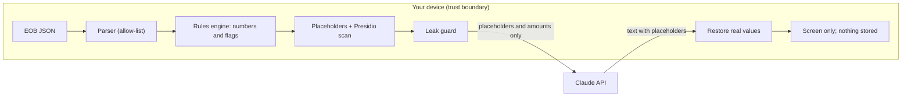

# Privacy design

This tool is built as if real PHI were involved, but uses synthetic or public data only.

## What leaves the device (cloud + redaction mode)

| Category | Examples | Handling |
|---|---|---|
| Sent | Dollar amounts and where each came from, claim type, service codes and code descriptions, line numbers, flag text | Sent as-is (needed to explain the claim) |
| Replaced by a placeholder, restored locally | Provider name, insurer name, service dates, any name/date found in free text | `[PROVIDER_1]`, `[INSURER_1]`, `[DATE_1]`, ... |
| Never parsed, so never sent | Patient name, ID, address, birth date; member IDs; claim number; provider IDs (NPI); diagnoses; supporting info; notes | Dropped by the allow-list parser |

In local mode (Ollama, Step 8) nothing leaves the device.

## Layers

1. **Allow-list schema.** The parser copies only declared fields. A leak of an undeclared field is a schema
   violation that a test catches, not a redaction step someone must remember.
2. **Known-value placeholders.** Values we know are sensitive are replaced with stable, reversible placeholders.
   The map lives in memory only.
3. **Presidio scan** (local) of the few free-text strings that come from the source document: people, places,
   and pattern-based identifiers (SSN, Medicare Beneficiary ID, NPI, phone, email, long IDs, full dates).
4. **Leak guard.** The exact outbound text is scanned again. Any known sensitive value or identifier-like pattern
   blocks the send (fail closed). Error messages never contain the sensitive content.
5. **Preview.** `scripts/preview_payload.py` prints exactly what would be sent. Nothing is sent by the preview.

## Data flow

## Residual risks and limits (stated honestly)

- Amounts, service codes and claim structure can in principle be quasi-identifiers. They are needed to explain the claim.
- Presidio's name/place detection is statistical and has imperfect recall. That is why it is the second layer, not the first.
- This is risk reduction, not HIPAA compliance. A real deployment would need a business associate agreement,
  security review, and legal sign-off.
- The leak guard blocks on patterns. It cannot recognize an arbitrary sensitive sentence.
- Not yet verified: no logging of document content and no disk writes (Step 10), and a network-isolation check for local mode (Step 10).

## Local mode (Ollama)

Local mode keeps everything on the device. The client enforces this in code, with tests:

- the server address must be loopback (localhost, 127.0.0.1 or ::1); anything else is refused;
- Ollama "cloud" model tags, which run on Ollama's servers, are refused;
- system proxy settings are ignored, so local traffic cannot be routed elsewhere.

It runs the same pipeline as cloud mode (placeholders, validator, fallback) so that evaluation compares models, not pipelines.
No consent prompt is needed because nothing leaves the machine.

Verified: with Wi-Fi switched off, local mode still produces an explanation.
Not verified: Ollama itself is third-party software and I have not audited its own network behavior (for example
update checks). A stricter check (running with outbound network blocked and watching connections) is planned for Step 10.
